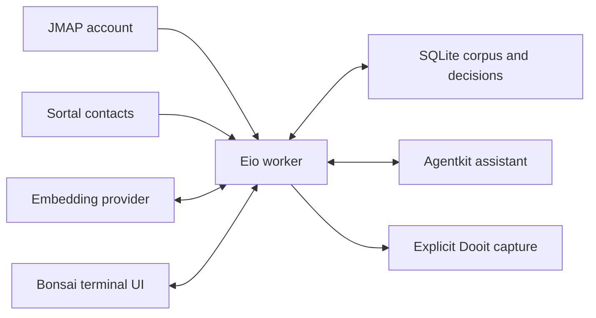

# Siftbot implementation plan

## Objective and status

Build an OCaml assistant that helps its admin organise email into meaningful
areas of activity. It imports a year of mail through JMAP, resolves people
through Sortal, proposes a classification, and learns from discussion and
corrections in a Bonsai terminal UI. It then classifies incoming mail and
summarises activity within the approved areas.

This document records the agreed design and implementation sequence. The
commands, package names and schemas below are planned interfaces.

The first usable release covers import, discovery, evaluation and interactive
review. The complete workflow adds continuous classification, attention state
and explicit Dooit task capture.

## Agreed constraints

- Labels and decisions live locally in SQLite.
- JMAP uses a read-only token. Reading does not change keywords, mailbox
  membership or read state.
- A later, separately configured integration can publish approved labels to
  JMAP. The classification model must not depend on server label names.
- Application code is OCaml and builds with the repository's OxCaml switch.
- Agentkit supplies the model and tool loop. Siftbot owns the email corpus,
  classification state and admin decisions.
- Use existing JMAP, Sortal, SQLite, Fetch and Bonsai libraries. Extract useful
  shared capabilities instead of making Siftbot depend on Crow's application.
- Keep the implementation small. Start with one local database and an explicit
  process boundary between Bonsai and Eio.
- Live account access and model-provider configuration are operator choices.
  Development and default tests use synthetic mail.

## Classification model

Classification has four independent dimensions.

| Dimension | Values and examples | Scope |
|---|---|---|
| Areas | Teaching, term preparation, Geotessera, another research project | Conversation, with message exceptions |
| Triage | Relevant, social, spam, uncertain | Message, with conversation defaults |
| Delivery | Direct, mailing list, broadcast, automated, uncertain | Message, with thread context |
| Attention | Needs my reply, waiting for someone, deadline approaching, FYI, uncertain | Conversation or a specific request |

Labels can overlap. A social invitation may also be relevant. An automated
deadline reminder may concern an important research project. A mailing-list
discussion can be relevant without being a broadcast.

### Areas and dated activities

An area has a stable ID, name, description, optional parent, status and revision.
Its definition includes positive examples and explicit exclusions. Areas begin
as proposals and become usable classification targets after admin approval.

Keep stable responsibilities distinct from dated activities. For example:

```text
University
  Teaching
    Michaelmas 2026 preparation
  Research
    Geotessera
    Project X
  Administration
```

An activity can carry dates and an active or archived state. Archiving retains
historical assignments. A conversation may belong to multiple areas. Do not
force every conversation into an area or merge areas because they share people.

### Assignment records

Each assignment records its target, dimension, value, origin, classifier or rule
version, source revision, supporting evidence and explanation. Predictions also
record a score and competing assignments. Treat scores as ranking signals until
evaluation establishes useful confidence thresholds.

Origins distinguish model suggestions, deterministic rules, explicit admin
decisions and observed server classifications. Human decisions take precedence.
Predictions do not become confirmed training examples without admin approval.

Message exceptions must remain visible when displaying a conversation default.
A suspicious message in a legitimate thread must not silently relabel the whole
conversation as spam.

## Architecture and repository layout

Place the package under `avsm/siftbot/`.



Proposed libraries:

| Library | Responsibility |
|---|---|
| `siftbot.model` | Domain records, identities, classification values and pure UI transitions |
| `siftbot` | Corpus, import, identity resolution, retrieval, discovery, evaluation, Agentkit and attention logic |
| `siftbot.protocol` | Bounded, versioned frontend/worker messages |
| `siftbot.ui` | Bonsai terminal views and review interactions |

Keep adapters and persistence details internal until another consumer needs
them. Public modules have explicit `.mli` files with user-facing ocamldoc.
Provide a Cmdliner backend CLI, a Bonsai review executable and a worker.

### Shared components

- Move Crow's reusable read-only JMAP transport capability into the JMAP
  library. Preserve its account and origin restrictions, and add the read
  methods required for incremental sync and bounded batch import.
- Use typed JMAP methods and codecs for headers, filters, bodies and threads.
- Reuse Sortal's contacts and dated affiliations. Contact storage stays owned
  by Sortal.
- Use `sqlite3-eio` for the authoritative store and `Agentkit.Turn` for bounded
  model/tool conversations and auditing.
- Use `Agentkit.Memo` for derived activity overviews where a summary tree helps
  bound context. Exact claims must refer back to source records.
- Reuse suitable Termanil terminal components, interaction patterns and worker
  protocol conventions. Extract small shared widgets when useful.
- Reuse Dooit's source links and capture interface for reviewed tasks.

### Bonsai and Eio boundary

Follow [Termanil's runtime boundary](avsm/termanil/DESIGN.md). Its installed
Bonsai/Async stack and the workspace Eio stack currently have incompatible
Cstruct interfaces. The frontend must not link the Eio backend.

Domain and protocol libraries contain values, never network clients, Eio
capabilities, credentials or callbacks. Use explicit, bounded, versioned
messages. A versioned S-expression protocol follows the existing Termanil
approach. Persisted structured records use clean Jsont codecs.

Start import and monitoring through the backend CLI. UI requests perform bounded
units of work and return durable job IDs or results. Keep the terminal responsive
while jobs run. A persistent worker may reuse sessions, but the first release
does not require a general daemon framework.

## Corpus and local storage

Use one SQLite database per Siftbot profile. Enable WAL and explicit schema
migrations. Keep database access in the worker, with one writer and revision
checks for concurrent review and background work.

Proposed record groups:

| Records | Purpose |
|---|---|
| Accounts and sync checkpoints | Service/account identity, server states, import progress and hydration jobs |
| Messages and headers | Account-scoped IDs, participants, dates, bodies, source revisions and delivery evidence |
| Conversations and relationships | Server threads, local associations, duplicate relationships and message membership |
| Identity matches | Sortal UIDs, observed addresses, reviewed associations and resolution evidence |
| Areas and activities | Definitions, hierarchy, dates, lifecycle and revisions |
| Assignments and evidence | Suggested and confirmed classifications with source references |
| Decisions and rules | Corrections, explanations, scope, revision history and undo information |
| Derived indexes | FTS text, summaries and embeddings keyed by source/model versions |
| Jobs and evaluations | Progress, failures, restart checkpoints, frozen evaluation runs and metrics |
| Attention and task links | Requests, deadlines, state transitions and Dooit source/capture receipts |
| Assistant history and tool audit | Admin discussion, bounded context and recorded tool outcomes |

Scope source identity by service, account and email ID. A bare email ID is not
a global key. Preserve original sources when associating duplicates or related
threads across accounts.

Source text and confirmed decisions are authoritative. Derived records include
source revisions and become stale when their inputs change. Deletions remove
the source from retrieval and invalidate dependent caches. Retain decision
history without presenting deleted content as current evidence.

## Read-only JMAP import and synchronisation

### Initial year import

1. Discover and bind the configured account and JMAP endpoint.
2. Capture an Email state anchor for subsequent catch-up.
3. Query the configured year interval with deterministic pagination.
4. Fetch metadata and required headers in batches respecting server limits.
5. Hydrate message text and relevant conversations, including the admin's
   replies. Mark context outside the year interval explicitly.
6. Commit each batch and its checkpoint atomically.
7. Catch up from the anchor, then record the state used for live monitoring.

Persist the exact interval when the job starts. Resuming must not move the date
boundary. If a paginated query becomes inconsistent, restart its staged listing
without discarding already reusable message bodies or the published corpus.
Expose partial conversation coverage and truncated bodies to the classifier.

Fetch bodies in bounded batches. Keep original text and a derived version with
quoted repetition and signatures removed. Record the extraction version. Begin
with text and HTML body values. Attachment extraction is a later extension.

### Incremental updates

Follow Email changes and update affected conversations. Commit data changes and
the corresponding server cursor together. Restart safely if the server can no
longer calculate changes. Avoid repeating inference for keyword-only changes
that do not alter its inputs.

Use the shared JMAP mirroring machinery where its contract applies. The current
`Jmap.Mirror` snapshot contract requires an unfiltered complete collection. Do
not pass a year-filtered query into that contract. Keep the bounded year import
explicit and reconcile it through change tracking.

The read-only capability validates every method in a batch. It excludes mail
creation, submission, updates and deletion even when the supplied token has
broader server permissions. Reading must not mark a message as seen.

## Conversation and delivery evidence

Preserve JMAP thread IDs, `Message-ID`, `In-Reply-To` and `References`. Also
retain `List-Id`, list posting and unsubscribe headers, `Auto-Submitted`, bulk
mail indicators, recipients and reply addresses when present.

Use list IDs as list identities. Distinguish an announcement from a discussion
using reply patterns, participants and content. Header absence is missing
evidence. An unsubscribe header alone does not establish spam, and a list header
alone does not establish broadcast delivery.

JMAP thread grouping is useful evidence. Local relationships also account for
duplicate delivery, threads split across accounts and related exchanges. Do
not merge conversations solely by subject. Keep ambiguous associations proposed
until reviewed, and retain the evidence for each association.

## Sortal identity resolution

Build an address index from Sortal contact UIDs and email addresses. Use explicit
address associations before weaker name or affiliation matches. Preserve
ambiguity instead of guessing which person owns an address.

For historical messages, use affiliations whose date interval includes the
message date. A person's current role must not overwrite historical context.
The admin can confirm that multiple addresses belong to one person. Save that
decision locally with provenance. Updating the Sortal store is a separate
explicit action if added later.

## Retrieval, embeddings and activity summaries

Use SQLite FTS5 for exact names, subjects, identifiers and terms. Add a vector
index with a pinned `sqlite-vec` build against the repository's SQLite. Verify
OxCaml/FFI compatibility and nearest-neighbour behaviour through consumer tests.
Document the imported version and any patches according to repository rules.

Define a small embedding-provider interface with bounded batches, cancellation
and model identity. Keep embedding inference separate from chat completion.
Configuration selects a local or remote provider. Cache by model, dimensions,
normalisation version and input hash. Changing providers requires rebuilding
the affected index, not the corpus.

Start with conversation summaries and representative message passages. Avoid
embedding repeated quoted text. Combine lexical and semantic retrieval with
participant, list and time filters. Similarity is evidence for an assignment,
not a substitute for its approved definition.

Maintain bounded area overviews linked to source conversations. Include dates,
participants, developments, open questions and attention items. Every generated
overview must identify its source range and indicate missing coverage.

## Discovery and interactive learning

### Proposing areas

Use semantic similarity, subjects, resolved participants, mailing lists and
activity over time to identify candidate areas. Sender domains provide evidence
without determining the classification.

Weight distinct conversations, participants and active days alongside message
counts. Limit the influence of duplicate deliveries, repeated announcements and
high-volume lists. Include small but substantial collaborations in the sample.

Each proposal contains a name, definition, representative conversations,
competing assignments, explicit exclusions, date range and activity counts.
Proposals remain separate from approved areas.

### Asking useful questions

Prioritise examples that would resolve a distinction, conflicting rules or an
emerging topic. Balance ambiguity with diversity and coverage. Do not fill the
queue with many copies of the same uncertain newsletter.

Questions should identify the decision being requested. For example:

> Are these supervision discussions teaching administration or Project X?

Store the answer and the admin's explanation. Use confirmed examples and
exclusions when classifying later conversations.

### Decisions and reversible rules

Support corrections scoped to a message, conversation, mailing list or a
reviewed future rule. Preview the examples affected by broader rules. Preserve
message exceptions when applying a broader default.

Keep predictions, confirmed decisions and rules distinct. Record revisions and
make changes reversible. Undo creates a new decision revision and invalidates
derived classifications as needed. Never train on an unconfirmed prediction as
if it were a human label.

## Bonsai terminal review

The main workspace has three panes:

1. Areas, activities and review queues with counts and recent activity.
2. Supporting conversations, original messages and disputed assignments.
3. An Agentkit discussion with the admin about the current selection.

Actions include accept, rename, merge, split, reassign, defer and undo. Show
triage, delivery and attention independently. Allow filters for uncertain mail,
social mail, suspected spam, broadcasts and messages requiring attention.

Keep selection and reader position across refreshes. Show pending operations,
progress and failures. Discard stale worker responses using request IDs and
record revisions. Sanitize message text for terminal rendering.

Provide a synthetic demo containing teaching, research, social, list discussion,
broadcast, automated reminders, spam and ambiguous examples. Include duplicate
delivery and a conversation that spans areas. Demo mode uses no live credentials.

## Agentkit integration

Offer bounded tools to search messages and conversations, inspect evidence,
resolve identities, read area definitions, compare assignments and propose
changes. Explicit review actions commit changes to local state.

Treat email content and retrieved summaries as source data. They do not alter
the assistant's tool permissions or supply admin instructions. Model-proposed
bulk rules and task captures enter the same preview and confirmation workflow.

Record model version, prompt version, source revisions and tool outcomes for
each classification job. Keep terminal logs to identifiers, counts and outcomes.
Detailed transcripts stay in the private profile store.

Bound tool calls, input text, result text and model output using Agentkit's turn
controls. Use retrieval and derived overviews to keep admin conversation context
bounded. A failed model turn must not commit partial decisions.

## Chronological evaluation

Import the full year, but initially discover areas from the older nine months.
Evaluate predictions on the newest three months using separately reviewed
examples. Freeze the area definitions, training decisions and model version for
each evaluation run.

Deduplicate before splitting. Training summaries, participant features and
conversation context must not include later messages from the evaluation
period. Using a conversation's future replies during discovery would leak
information into the earlier period.

Report:

- Area assignment accuracy and competing-area confusion on reviewed examples.
- Corrections per triage, delivery and attention label.
- Missed relevant mail and false spam predictions.
- Coverage, abstention rate and review burden at different score thresholds.
- Results by list, sender group and time period where sample size permits.
- Network, embedding and model work performed during import and evaluation.

Show denominators and uncertainty for small samples. Raw model scores are not
calibrated probabilities. Set automation thresholds from observed results.
After evaluating, incorporate confirmed examples from the full year and retain
the frozen evaluation for comparison with future versions.

## Attention state and Dooit capture

Identify concrete requests, pending replies and deadlines with source excerpts.
Distinguish inferred state from confirmed state. An automated notice may be FYI
or require action depending on the actual request and approved context.

Update attention when replies arrive, deadlines pass or the admin corrects it.
Record the evidence for each transition. Defer or snooze an item locally without
changing JMAP flags. New evidence can reopen a resolved item, with an explanation.

Offer task capture only after previewing the proposed title, deadline, area and
source links. Reuse Dooit's existing email references. Check existing links and
capture receipts to avoid creating a task for every repeated reminder. Report
capture failures explicitly and retain enough state for safe retry.

## Planned commands and configuration

```sh
siftbot init --profile personal --jmap-profile personal
siftbot learn --profile personal --since 1y
siftbot review --profile personal
siftbot evaluate --profile personal
siftbot watch --profile personal
siftbot inspect --profile personal
siftbot review --demo
```

`learn` persists the resolved interval and resumes incomplete jobs. Discovery
and evaluation can resume independently of import. `watch` reports new and
changed classifications and durable job status. `inspect` supports corpus,
areas, decisions, attention, jobs and recorded tool activity.

Profile configuration names JMAP accounts, Sortal roots, chat and embedding
providers, import/body limits, job budgets and optional Dooit integration. Use
the shared JMAP profile store for authentication. Resolve configuration and
data through XDG paths. Keep credentials out of worker messages and model input.

Before a large run, report the account, date interval, available message counts,
configured providers and work limits. Persist progress and cumulative work so
the operator can pause or resume without repeating completed inference.

## Implementation phases

### Phase 1: Corpus and protocol foundation

- [ ] Add the package, domain records, explicit interfaces and profile layout.
- [ ] Extract and test the shared read-only JMAP capability.
- [ ] Implement atomic migrations, scoped identities and resumable year import.
- [ ] Add headers, conversation hydration and incremental catch-up.
- [ ] Add Sortal resolution, dated affiliations and duplicate relationships.
- [ ] Add inspection commands and synthetic fixtures.

Acceptance: import resumes after interruption, published records remain
consistent, updates and deletions invalidate derived data, and mocked requests
prove that no JMAP mutation is available.

### Phase 2: Retrieval, discovery and evaluation

- [ ] Integrate FTS5 and the vector index with a configurable embedding adapter.
- [ ] Add revisioned summaries, retrieval and candidate area proposals.
- [ ] Balance discovery across conversations, participants and active days.
- [ ] Add chronological splitting, reviewed examples and frozen evaluations.
- [ ] Produce evidence-linked assignments and per-label reports.

Acceptance: derived work is cached and restartable, proposals are reproducible
for fixed inputs, evaluation has no future-context leakage, and the report shows
the trade-off between coverage and review burden.

### Phase 3: Bonsai review and Agentkit discussion

- [ ] Add the frontend/worker protocol and synthetic demo.
- [ ] Implement the three-pane UI, filters and keyboard actions.
- [ ] Add Agentkit evidence tools and bounded admin discussion.
- [ ] Implement useful-question selection and stored explanations.
- [ ] Add scoped corrections, previews, revision checks and undo.

Acceptance: the admin can import, discover, evaluate and review a year of mail
without server writes. Decisions survive restart, take precedence over new
predictions and can be reversed. This is the first usable release.

### Phase 4: Continuous classification and actionable activity

- [ ] Follow JMAP changes with durable monitoring checkpoints.
- [ ] Add uncertainty, emerging-topic and area activity queues.
- [ ] Maintain evidence-linked attention state and local snoozes.
- [ ] Add explicit Dooit capture with source deduplication and receipts.
- [ ] Re-evaluate classifier and rule revisions before adopting them.

Acceptance: monitoring survives restart, reuses unchanged inference, exposes
failures, updates attention from new evidence and creates no duplicate tasks.

### Later extension: Publish labels to JMAP

- [ ] Add an independently configured writer capability.
- [ ] Map stable local labels to selected server mailboxes or keywords.
- [ ] Preview the exact mutations and retain export receipts.
- [ ] Preserve unrelated server labels and report conflicts.

The local classification system remains usable without this extension.

## Verification strategy

Use focused tests for the properties that can lose data or produce misleading
decisions. Force scoped test runs under the repository's OxCaml switch.

- Mock JMAP tests cover pagination, server limits, changing queries, thread
  hydration, interruption, expired change states and account/origin confinement.
- Capability tests reject every mutation, including mixed read/write batches,
  before transport.
- Store tests cover migrations, atomic checkpoints, deletion, cache invalidation,
  decision precedence, revision conflicts and undo.
- Identity tests cover ambiguous addresses, reviewed aliases and affiliation
  date boundaries.
- Classification fixtures cover discussion versus broadcast, missing headers,
  overlapping areas, per-message exceptions and newsletter volume imbalance.
- Retrieval tests cover vector results, FTS matches, source attribution, provider
  changes and stale index entries.
- Evaluation tests detect duplicate leakage and future replies in training
  summaries, and verify metric denominators and abstentions.
- Bonsai expect tests cover navigation, previews, undo, stale responses, progress
  and failures. Worker tests cover protocol bounds and version mismatches.
- Agentkit tests cover tool budgets, source-data handling, failed turns and
  separation of suggestions from committed decisions.
- Monitoring and Dooit tests cover restart, attention transitions and duplicate
  capture prevention.

Run a bounded real-model trial against synthetic fixtures when introducing the
model-driven path. Real mailbox learning is an operator-run phase after profile
configuration. Use chronological reviewed results to assess usefulness before
enabling continuous classification.

## Decisions to settle during implementation

- Select the initial chat and embedding providers and record their model IDs.
- Probe the vector extension against the workspace SQLite and OxCaml toolchain.
- Choose default batching and body limits from bounded fixture measurements.
- Define review thresholds from the first evaluation rather than arbitrary
  confidence numbers.
- Confirm which small Termanil components warrant extraction for both UIs.

These choices must not change the agreed local-label, read-only JMAP workflow.

## References

- [Termanil architecture](avsm/termanil/DESIGN.md).
- [Agentkit turn interface](bleeding/agentkit/agentkit/turn.mli).
- [Agentkit derived summary tree](bleeding/agentkit/agentkit/memo.mli).
- [JMAP mirror contract](bleeding/jmap/lib/core/mirror.mli).
- [Crow's current read-only mail capability](avsm/crowthebot/lib/email_client.mli).
- [Sortal contact and affiliation schema](avsm/sortal/lib/schema/sortal_schema_contact_v2.mli).
- [Dooit email capture](avsm/dooit/README.md).
- [JMAP mail and threading](https://www.rfc-editor.org/rfc/rfc8621.html).
- [Mailing-list identity](https://www.rfc-editor.org/info/rfc2919/).
- [Automatic response headers](https://www.rfc-editor.org/info/rfc3834/).
- [SQLite vector extension](https://github.com/asg017/sqlite-vec).
