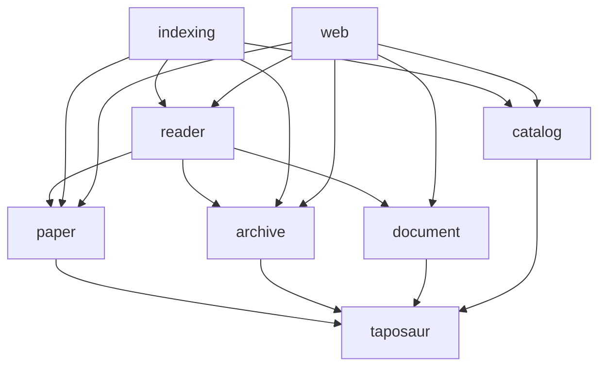

# Architecture

Each library owns one boundary. The CLI and Proffer website compose the
libraries. Neither is an implementation dependency of another library.

## Libraries

| Library | Owns | Does not own |
| --- | --- | --- |
| `taposaur` | Identities, corpus codecs, layout, bibliography and summaries | I/O or metadata selection |
| `taposaur.paper` | Pure evidence selection and resolved paper records | Parsers, filesystem, SQLite or HTML |
| `taposaur.archive` | Confined Eio access to corpus files and manifest snapshots | Document interpretation or writes |
| `taposaur.document` | Bounded readers by document format, TEI rendering | Archive paths or selection between documents |
| `taposaur.reader` | Loading document observations and resolving one archive paper | Database handles or persistence |
| `taposaur.catalog` | SQLite queries, atomic publications and cache snapshots | Archive access, document readers or resolver policy |
| `taposaur.indexing` | Import, enrichment and audit workflows | SQL implementation or HTML |
| `taposaur.web` | HTTP routing, artifact responses and views | Metadata selection or background indexing |

Arrows show project dependencies. External dependencies are omitted.

Separate Dune libraries enforce these boundaries. In particular, linking
`paper` does not pull in Eio, XML, SQLite or HTML. Linking `catalog` does
not pull in archive or document readers. The server does not link the
indexing workflows.

## Data models

- `Uid.t` is an identity. `Uid.of_input` handles user input consistently
  across the CLI and search. `Layout` owns sharding and path conventions.
- `Manifest.t`, `Index.t` and `Event.t` describe the corpus wire formats.
  They do not decide which document to read.
- `Bibliography.t` contains plain metadata values, independent of format.
  TEI, Elsevier XML and S2ORC readers return this same type.
- `Taposaur_paper.t` preserves the manifest, optional original index,
  document observations, selected values and alternatives. Its resolved
  records are private, so callers construct them through `resolve`.
- `Summary.t` contains a UID, bibliography and holdings flags. It is the
  public search result. It carries no archive paths or synthetic index
  fields.

An `Archive.paper` is a read capability with a cached manifest snapshot.
A `Paper.t` is an immutable resolved value. Finding the archive paper
again refreshes the manifest. Loading it through `Reader.load` reads the
listed documents and delegates all selection to `Paper.resolve`.

`Paper.bibliography` strips evidence for the search cache. `Paper.presence`
reports selected title, abstract and publisher availability. Applications
can inspect every candidate and failure without reparsing the files.
Document ranking and preferred reading artifacts belong to `paper`.
Views do not repeat those decisions.

## Catalogue interface

`Catalog.open_read` returns `Catalog.read Catalog.t`.
`Catalog.open_write` returns `Catalog.write Catalog.t`. Queries accept
both. Publication requires the write handle. The web environment accepts
only a read handle. SQLite also opens read handles in read-only mode.

`Catalog.Query` describes predicates without a database handle. `search`
and `find` return `Summary.t`. `find_index` explicitly returns the original
imported `Index.t`. Resolvers must use that original row, never a cached
result from their own previous run.

`Catalog.Shard.replace` accepts a row-producing callback. It stages the
stream in bounded batches, validates shard membership and uniqueness,
then publishes the rows, FTS entries and counters in one transaction.
The callback performs source checks before returning. An exception leaves
the previous shard intact. The callback must not reenter the same handle.

`Catalog.Metadata.pending` returns opaque snapshots containing source
rows. `publish` accepts bibliography or a failure. It checks the raw row
and shard generation before committing. A shard replacement invalidates
old snapshots even when its rows are byte-identical. Success updates
metadata and FTS atomically. Failure retains the last successful cache.

Schema migration is private to the catalogue. Version 3 adds complete
bibliography storage and shard generations. Legacy cached projections
remain readable, so upgrading does not discard completed enrichment.

## Workflows and applications

`Indexing.Import` reads shard stamps, streams rows, checks source
stability and records failures. `Indexing.Enrich` owns resolver versioning,
concurrency, resumable selection and progress. `Indexing.Audit` owns
sample validation and coverage classification. These functions operate on
caller-supplied capabilities. The CLI owns switches, arguments and output.

The web layer has a private HTML view interface and a separate artifact
response module. Views accept records, not handles. HTTP code handles
request parsing, range requests and status codes. It calls `Reader.load`
for paper pages and `Catalog.search` for listings.

New publisher formats belong in `document` and return `Bibliography.t`.
New acquisition or conversion workflows should be separate libraries with
CLI entry points before web integration. Archive mutation, review state
and persistent job scheduling remain separate future responsibilities.

## Verification

The tests exercise independent storage publications, generation conflicts,
legacy schema migration, multi-document resolution, parser limits and HTTP
behavior. The architecture review also compares rendered preview pages
before and after the refactor. The read/write handle distinction is checked
by the OCaml compiler.
