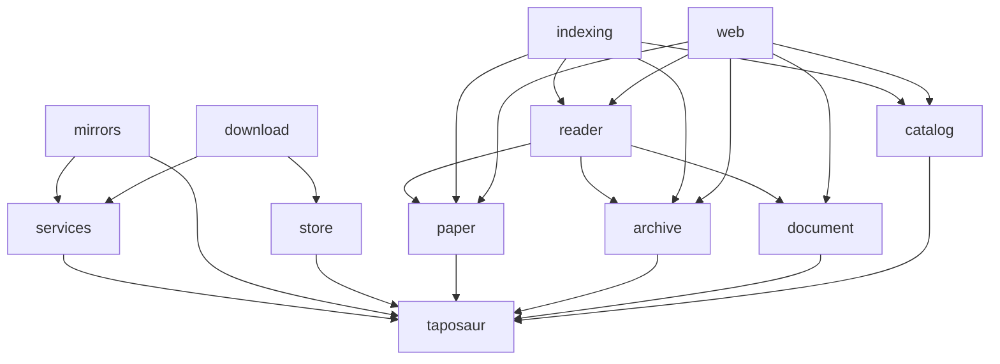

# Architecture

Each library owns one boundary. The CLI and Proffer website compose the
libraries. Neither is an implementation dependency of another library.

## Libraries

| Library | Owns | Does not own |
| --- | --- | --- |
| `taposaur` | Identities, corpus codecs, layout, bibliography and summaries | I/O or metadata selection |
| `taposaur.paper` | Pure evidence selection and resolved paper records | Parsers, filesystem, SQLite or HTML |
| `taposaur.archive` | Confined Eio access to corpus files and manifest snapshots | Document interpretation or writes |
| `taposaur.document` | Bounded readers by document format, TEI rendering | Archive paths or selection between documents |
| `taposaur.reader` | Loading document observations and resolving one archive paper | Database handles or persistence |
| `taposaur.catalog` | SQLite queries, atomic publications and cache snapshots | Archive access, document readers or resolver policy |
| `taposaur.indexing` | Import, enrichment and audit workflows | SQL implementation or HTML |
| `taposaur.mirrors` | Exact DOI publisher lookups, retained responses and audit | Paper fetching, archive mutation or catalogue writes |
| `taposaur.services` | Publisher and metadata HTTP clients | Environment loading or filesystem writes |
| `taposaur.store` | Staging locks, events and recoverable publication | Accepted archive mutation or acquisition policy |
| `taposaur.download` | Source selection, transfer and validation | Credentials from the environment or bulk scheduling |
| `taposaur.review` | Query definitions, DOI sets and frozen metadata | I/O or database handles |
| `taposaur.review-store` | Durable requests, revisions, runs and snapshots | Catalogue or archive access |
| `taposaur.review-run` | Local review execution and capture | Network access or HTML |
| `taposaur.web` | HTTP routing, artifact responses and views | Metadata selection or background indexing |

Arrows show project dependencies. External dependencies are omitted.

Separate Dune libraries enforce these boundaries. In particular, linking
`paper` does not pull in Eio, XML, SQLite or HTML. Linking `catalog` does
not pull in archive or document readers. The server does not link the
indexing workflows.

## Data models

- `Uid.t` is an identity. `Uid.of_input` handles user input consistently
  across the CLI and search. `Layout` owns sharding and path conventions.
- `Manifest.t`, `Index.t` and `Event.t` describe the corpus wire formats.
  They do not decide which document to read.
- `Bibliography.t` contains plain metadata values, independent of format.
  TEI, Elsevier XML and S2ORC readers return this same type.
- `Taposaur_paper.t` preserves the manifest, optional original index,
  document observations, selected values and alternatives. Its resolved
  records are private, so callers construct them through `resolve`.
- `Summary.t` contains a UID, bibliography and holdings flags. It is the
  public search result. It carries no archive paths or synthetic index
  fields.

An `Archive.paper` is a read capability with a cached manifest snapshot.
A `Paper.t` is an immutable resolved value. Finding the archive paper
again refreshes the manifest. Loading it through `Reader.load` reads the
listed documents and delegates all selection to `Paper.resolve`.

`Paper.bibliography` strips evidence for the search cache. `Paper.presence`
reports selected title, abstract and publisher availability. Applications
can inspect every candidate and failure without reparsing the files.
Document ranking and preferred reading artifacts belong to `paper`.
Views do not repeat those decisions.

## Catalogue interface

`Catalog.open_read` returns `Catalog.read Catalog.t`.
`Catalog.open_write` returns `Catalog.write Catalog.t`. Queries accept
both. Publication requires the write handle. The web environment accepts
only a read handle. SQLite also opens read handles in read-only mode.

`Catalog.Query` describes predicates without a database handle. `search`
and `find` return `Summary.t`. `find_index` explicitly returns the original
imported `Index.t`. Resolvers must use that original row, never a cached
result from their own previous run.

`Catalog.Shard.replace` accepts a row-producing callback. It stages the
stream in bounded batches, validates shard membership and uniqueness,
then publishes the rows, FTS entries and counters in one transaction.
The callback performs source checks before returning. An exception leaves
the previous shard intact. The callback must not reenter the same handle.

`Catalog.Metadata.pending` returns opaque snapshots containing source
rows. `publish` accepts bibliography or a failure. It checks the raw row, shard generation
and metadata revision before committing. A shard replacement invalidates
old snapshots even when its rows are byte-identical. Success updates
metadata and FTS atomically. Failure retains the last successful cache. Partial resolutions preserve document
diagnostics alongside the selected bibliography. Source checks invalidate
snapshots without discarding cached values. Metadata counters are maintained
by triggers in the publication transaction.

Schema migration is private to the catalogue. Version 3 adds complete
bibliography storage and shard generations. Legacy cached projections
remain readable, so upgrading does not discard completed enrichment.
Version 4 adds source stamps, document diagnostics, metadata revisions,
loader versions and maintained metadata counters.
Version 5 adds maintained journal counts for bounded autocomplete queries.
Version 6 adds detail JSON, its saved timestamp and maintained cache counts.
Detail publication uses the same transaction and generation/revision guard as
search metadata. The payload contains a manifest and document observations.
The pure paper library reconstructs provenance using the original index row.

## Workflows and applications

`Indexing.Import` reads shard stamps, streams rows, checks source
stability and records failures. `Indexing.Enrich` owns resolver versioning,
concurrency, resumable selection and progress. `Indexing.Audit` owns
sample validation and coverage classification. These functions operate on
caller-supplied capabilities. The CLI owns switches, arguments and output.

The web layer has a private HTML view interface and a separate artifact
response module. Views accept records, not handles. HTTP code handles
request parsing, range requests and status codes. It calls `Reader.load`
for complete paper details and `Catalog.search` for listings. Indexed paper
pages first use the complete detail cache without archive I/O. Uncached
pages initially use `Catalog.find`. The browser fetches
complete details separately, retaining the initial bibliography on failure.
An external script adds journal autocomplete and cached TEI/history panels.
The same reading routes serve fragments or standalone pages. Paper details
remain visible while switching panels, including on narrow screens.

New publisher formats belong in `document` and return `Bibliography.t`.
Acquisition uses the separate services, download and store libraries. Store
accepts only papers owned by the staging writer. Its durable intent records
an event and its original append offset. Recovery finishes the artifact and
any partial append, then rebuilds the manifest. No index publication or main
archive acceptance is implicit. Conversion, archive acceptance, review state
and persistent scheduling remain separate future responsibilities.

## Verification

The tests exercise independent storage publications, generation conflicts,
legacy schema migration, multi-document resolution, parser limits and HTTP
behavior. The architecture review also compares rendered preview pages
before and after the refactor. The read/write handle distinction is checked
by the OCaml compiler.

## Review definitions and deliveries

`taposaur.review` owns pure, versioned query definitions, input parsing,
set selection, frozen bibliographic observations and deterministic exports.
It depends on the core bibliography and identity types. It has no I/O.

`taposaur.review-store` owns a separate local SQLite database. Review identity
is fixed. Definition revisions use an expected-head comparison. Runs derive
membership from retained inputs. Snapshots preserve that membership and
freeze metadata separately. Inputs, observations and exports are deduplicated
by SHA-256 inside the database. A snapshot, its rows, its manifest and its
three exports and coverage statistics publish in one transaction. Statistics
count recorded holdings and metadata presence from frozen observations, with
publisher groups. The `statistics-v1` cached object uses the exports table.
Older snapshots can acquire that derived cache without rewriting manifests.
Schema 2 adds `snapshot_facets`, with frozen presence flags and trimmed
publisher names. Expression indexes serve each presence filter in DOI order.
A publisher index serves combined publisher and presence filters. A ready
marker publishes with the complete cache. `cache-statistics` backfills both
statistics and browsing indexes transactionally. Pages never resolve papers
or scan observation JSON to filter membership.
Public APIs do not mutate history.

`taposaur.review-run` connects the store to read-only catalogue snapshots.
It executes local DOI searches or accepts externally recorded results. It
does not access the archive or network. All local queries in one run share a
read transaction. Metadata capture for a fixed run uses a separate consistent
read transaction. No review database writes occur while that transaction is
held. Failed captures publish no snapshot and are restarted from fixed run
membership. Resource budgets fail explicitly instead of truncating results.

The CLI owns writes and caller-supplied actor attribution. The browser owns
only read handles and never executes review queries, resolves source papers,
or regenerates exports. The paper catalogue remains rebuildable. Review state
must be backed up independently using a consistent SQLite backup.
